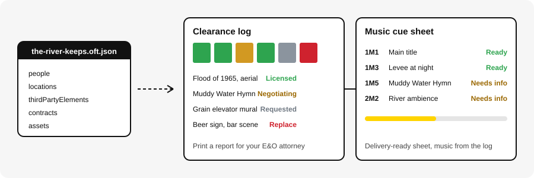

<p align="center">
  <picture>
    <source media="(prefers-color-scheme: dark)" srcset="docs/assets/logo-dark.svg" />
    
  </picture>
</p>

<p align="center">
  <b>Free tools for the paperwork behind a documentary or independent film. No accounts, no cloud, no subscriptions.</b>
</p>

<p align="center">
  <a href="https://github.com/open-filmmaker-toolkit/toolkit/actions/workflows/ci.yml"></a>
  <a href="https://github.com/open-filmmaker-toolkit/toolkit/actions/workflows/dco.yml"></a>
  
  <a href="#licenses"></a>
  
  
  
</p>

# Open Filmmaker Toolkit

Free, open-source tools and templates for documentary and independent narrative filmmakers. Open a tool in your browser, load your project file, and keep working: your data never leaves your computer.



> **Status:** Early release. Every tool is a first version, so expect rough edges, and tell us what's broken or missing from the [new issue page](https://github.com/open-filmmaker-toolkit/toolkit/issues/new/choose). Where it's headed: the [**Roadmap**](ROADMAP.md).

## Contents

- [Quick start](#quick-start)
- [What this is](#what-this-is)
- [The tools](#the-tools)
- [How our tools work](#how-our-tools-work)
- [Shared project file](#shared-project-file)
- [Who it's for](#whos-it-for)
- [Repository layout](#repository-layout)
- [Validation](#validation)
- [Licenses](#licenses)
- [Not legal advice](#not-legal-advice)
- [Maintainers](#maintainers)
- [Contributing](#contributing)

## Quick start

The easiest way in is the [toolkit's home page](https://open-filmmaker-toolkit.github.io/toolkit/): every tool, by stage of production, with how they connect. Click a tool to use it in your browser.

To use the tools offline, or to work on them:

1. Clone the repo, or [download it as a ZIP](https://github.com/open-filmmaker-toolkit/toolkit/archive/refs/heads/main.zip):
   ```bash
   git clone https://github.com/open-filmmaker-toolkit/toolkit.git
   ```
2. Open [`tools/clearance-log/index.html`](tools/clearance-log/index.html) in Chrome, Edge, Firefox or Safari.
3. Click **Open file** and choose [`samples/the-river-keeps.oft.json`](samples/the-river-keeps.oft.json).
4. Make a change, then save. The same file opens in the [music cue sheet](tools/music-cue-sheet/index.html).

That's it. No install, no build step, no account. Each tool is one self-contained HTML file. Open [`index.html`](index.html) for the home page, which works offline too.

## What this is

The toolkit has two halves:

1. **Tools we build to fill the gaps,** especially the paperwork that runs on hand-built spreadsheets today: clearances, releases, rights, funding and impact. They are listed by production phase in [TOOLS.md](TOOLS.md).
2. **A directory of other people's open-source tools,** sorted by production phase, so filmmakers don't pay for what's already free. See [Other open-source tools](docs/other-tools.md), also linked from the home page.

## The tools

| Tool | Phase | Use it for |
| --- | --- | --- |
| [Subject tracker](tools/subject-tracker/) | Development | Track people you might film and when to follow up. |
| [Research and archival log](tools/research-log/) | Development | Log archival leads and sources. |
| [Comps tracker](tools/comps-tracker/) | Development | Track comparable films and where each number came from. |
| [Treatment builder](tools/treatment-builder/) | Development | Write your treatment section by section. |
| [Pitch deck builder](tools/pitch-deck/) | Development | Build a pitch deck from your project and stills. |
| [Grant calendar](tools/grant-calendar/) | Funding | Track grant deadlines and what each application needs. |
| [Grant narrative library](tools/narrative-library/) | Funding | Keep your application answers in every length. |
| [Budget converter](tools/budget-converter/) | Funding | Convert your budget to a funder's categories. |
| [Finance plan](tools/finance-plan/) | Funding | See how the film gets paid for and what's left to raise. |
| [Funder CRM](tools/funder-crm/) | Funding | Track funder contacts and next steps. |
| [Budget](tools/budget/) | Pre-production | Build a budget from detail lines up to a top sheet. |
| [Cash flow](tools/cash-flow/) | Pre-production | See when money comes and goes, and when you'll run short. |
| [Script breakdown](tools/script-breakdown/) | Pre-production | Break down a script into scenes, cast and props. |
| [Stripboard](tools/stripboard/) | Pre-production | Arrange the script's scenes into shoot days. |
| [Day-out-of-days](tools/day-out-of-days/) | Pre-production | See which days each cast member works. |
| [Shot list and storyboard](tools/shot-list/) | Pre-production | Plan the shots for each scene, with frames. |
| [Shooting calendar](tools/shooting-calendar/) | Pre-production | Schedule shoot days, travel and holds. |
| [Interview prep](tools/interview-prep/) | Pre-production | Prepare research and questions for each interview. |
| [Location scout sheet](tools/location-scout/) | Pre-production | Record scouts with photos for the crew. |
| [Deal memos](tools/deal-memos/) | Pre-production | Print crew deal memos and send rates to the budget. |
| [Gear list](tools/gear-list/) | Pre-production | Track your gear and what goes out each day. |
| [COI and permit tracker](tools/coi-permit-tracker/) | Pre-production | Track certificates and permits for each shoot day. |
| [Travel sheet](tools/travel-sheet/) | Pre-production | Put flights, hotels and contacts on one sheet. |
| [Risk and hostile-environment plans](tools/risk-plan/) | Pre-production | Plan for what could go wrong on a shoot. |
| [Security checklist](tools/security-checklist/) | Pre-production | Protect footage, sources and devices. |
| [Call sheet](tools/call-sheet/) | Production | Build call sheets from your project. |
| [Sides](tools/sides/) | Production | Print the day's scenes for cast and crew. |
| [Camera and sound reports](tools/camera-sound-reports/) | Production | Log what's on each camera and sound card. |
| [Interview log](tools/interview-log/) | Production | Log interviews and their best moments. |
| [Daily production report](tools/daily-production-report/) | Production | Report each shoot day's hours, footage and problems. |
| [Expense log](tools/expense-log/) | Production | Log spending against the budget, with receipts. |
| [Release tracker](tools/release-tracker/) | Production | Track who's signed a release and who hasn't. |
| [Field journal](tools/field-journal/) | Production | Keep a dated production journal. |
| [Footage log](tools/footage-log/) | Post-production | Catalog every clip so the editor can find it. |
| [Paper edit](tools/paper-edit/) | Post-production | Build scenes from transcripts and export an edit list. |
| [Structure board](tools/structure-board/) | Post-production | Rearrange scene cards until the structure works. |
| [Cut version tracker](tools/cut-tracker/) | Post-production | Track each cut, who saw it and their notes. |
| [Name supers list](tools/name-supers/) | Post-production | Keep on-screen names and titles correct. |
| [Music cue sheet](tools/music-cue-sheet/) | Post-production | Build the music cue sheet from your clearance log. |
| [Credits builder](tools/credits-builder/) | Post-production | Build end credits and check what your contracts require. |
| [Budget-to-actuals](tools/budget-to-actuals/) | Post-production | Compare spending to the budget, line by line. |
| [Clearance log](tools/clearance-log/) | Legal and clearances | Track third-party material until it's cleared. |
| [Fair use log](tools/fair-use-log/) | Legal and clearances | Write up your fair use reasoning for your attorney. |
| [License tracker](tools/license-tracker/) | Legal and clearances | Track license terms, payments and expiry dates. |
| [Annotated-transcript clearance report](tools/clearance-report/) | Legal and clearances | Annotate the script for your E&O insurer. |
| [Chain-of-title binder](tools/chain-of-title/) | Legal and clearances | Gather the rights documents a distributor needs. |
| [Festival submission tracker](tools/festival-submissions/) | Marketing and festivals | Track festival deadlines, fees and results. |
| [Press list](tools/press-list/) | Marketing and festivals | Track press contacts, screeners and coverage. |
| [Festival strategy map](tools/festival-strategy/) | Marketing and festivals | Plan a festival run that protects your premiere. |
| [EPK and press notes builder](tools/press-notes/) | Marketing and festivals | Build press notes from your project and print them. |
| [Stills library](tools/stills-library/) | Marketing and festivals | Caption, credit and approve your stills. |
| [Awards and social calendars](tools/awards-social/) | Marketing and festivals | Plan awards and social posts around your festival dates. |
| [Rights availability matrix](tools/rights-matrix/) | Release and distribution | See which rights you've sold, by territory and media. |
| [Deliverables checklist](tools/deliverables/) | Release and distribution | Track every deliverable a distributor asks for. |
| [QC tracker](tools/qc-tracker/) | Release and distribution | Track QC issues and fixes until the master passes. |
| [Recoupment waterfall model](tools/waterfall/) | Release and distribution | Model who gets paid, and in what order. |
| [Revenue tracker](tools/revenue-tracker/) | Release and distribution | Log revenue statements and see the totals. |
| [Educational and theatrical booking trackers](tools/bookings/) | Release and distribution | Track educational licenses and screening bookings. |
| [Partner CRM](tools/partner-crm/) | Impact and outreach | Track impact partners and shared screenings. |
| [Discussion guide builder](tools/discussion-guide/) | Impact and outreach | Make a screening handout with discussion questions. |
| [Theory of change builder](tools/theory-of-change/) | Impact and outreach | Map how your campaign leads to change, and how you'll measure it. |
| [Screening kit builder](tools/screening-kit/) | Impact and outreach | Put together a kit for the people hosting screenings. |
| [Impact report](tools/impact-report/) | Impact and outreach | Report on your campaign against your theory of change. |
| [Archive log](tools/archive-log/) | Close-out and archive | Track where each copy of your project lives. |
| [Final cost report](tools/final-cost-report/) | Close-out and archive | Close out the budget with final costs. |
| [Grant final reports](tools/grant-reports/) | Close-out and archive | Write each grant's final report before it's due. |
| [Contract and release archive](tools/contract-archive/) | Close-out and archive | Index every signed contract and release for the long term. |

All 67 are first versions: they work, and they're still changing. To ask for another tool, use the [request form](https://github.com/open-filmmaker-toolkit/toolkit/issues/new?template=request-a-tool.yml).

## How our tools work

- **Forever free.** No subscriptions, no paid tiers, no "pro" version.
- **Local-first.** Every tool runs in your browser or on your own machine. No accounts and no cloud. Your project data never leaves your computer.
- **Works offline.** Each tool is one HTML file. Keep a copy on your laptop and it works on set with no signal.
- **One shared project file.** All tools read and write the same project. Add a person once and they show up in your call sheets, releases, name supers and credits; log an archival clip once and it flows from the research log to the clearance log to the credits.
- **Your file, your copy.** Projects save as a file on disk that you back up and share however you already do (Drive, Dropbox, a hard drive).
- **Work together without a server.** Keep the file in a folder your sync app shares. The tools say who has it open and who changed what, and merge two copies when people save at once. See [Working on a shared file](docs/sharing-a-project.md).
- **See the whole project.** Open the project file on the [home page](https://open-filmmaker-toolkit.github.io/toolkit/) to see what needs you across every tool, add every date to your calendar, or make a read-only summary to share.
- **Plain templates too.** Most tools also have a blank spreadsheet or Word [template](templates/) for people who'd rather not use the tool.

## Shared project file

Tools share a local `.oft.json` project file. Its version 1 format is described by the [JSON Schema](schemas/project-v1.schema.json), with the [data model notes](schemas/README.md) and a [sample project](samples/the-river-keeps.oft.json). Tools preserve fields they do not own when saving.

## Who it's for

Documentary and independent narrative filmmakers, producers, coordinators and ADs working without a studio's back office.

## Repository layout

```text
toolkit/
|-- index.html            # The home page: every tool by stage, how they connect, search
|-- tools/                # One folder per tool: index.html plus its own README
|-- schemas/              # JSON Schema and data model notes for the project file
|-- samples/              # Fictional sample project to try the tools with
|-- templates/            # Blank templates for people who don't use the tools
|-- tests/                # Browser tests CI runs in Chromium
|-- shared/               # Code every tool needs, copied into each page by .github/scripts/sync_shared.py
|-- docs/                 # Guides, the directory of other open-source tools; logo and artwork in docs/assets/
|-- .github/
|   |-- workflows/        # DCO and CI checks
|   `-- scripts/          # validate_repo.py, the check CI runs, and sync_shared.py
|-- TOOLS.md              # Every tool we build or plan to, by production phase
|-- ROADMAP.md            # Milestones, each linked to its issue
|-- GOVERNANCE.md         # How decisions get made
|-- CONTRIBUTING.md       # How to contribute, DCO sign-off, CI practices
`-- README.md             # This page
```

## Validation

CI checks the project schema against the sample files, that IDs and references in samples resolve, that every tool has a README and makes no network requests, that the home page lists every tool just as TOOLS.md does, and that templates are plain spreadsheets or Word files with no macros or external links. Run the same check locally:

```bash
python3 -m pip install jsonschema
python3 .github/scripts/validate_repo.py
```

CI also runs [browser tests](tests/browser_tools.py) in Chromium: opening and saving the sample, CSV exports, the save-conflict warning, phone width, dark mode and print layout. A second run turns off Chromium's file access, to test the download-and-upload saving that Firefox and Safari use. A weekly check runs the basics in the real Firefox and Safari. CI can't judge look and feel or drive a real printer or phone. Those checks are manual: see [Before you open a pull request](CONTRIBUTING.md#before-you-open-a-pull-request).

## Licenses

Copyright © 2026 the Open Filmmaker Toolkit contributors. Contributors keep the copyright to their work and share it under these licenses:

| What | Where | License |
| --- | --- | --- |
| Code | The tools, project schema, sample project, tests and CI scripts | [GPL-3.0-or-later](LICENSE) |
| Templates, guides and documentation | `templates/` (except legal forms), `docs/`, and the README and other Markdown files | [CC BY-SA 4.0](LICENSES/CC-BY-SA-4.0.txt) |
| Legal forms, such as releases and deal memos | `templates/legal-forms/` | [CC0 1.0](LICENSES/CC0-1.0.txt): no rights reserved, so you can turn a form into your own contract without crediting us |

If we ever run a tool as a hosted service, that code will be under AGPL-3.0.

## Not legal advice

The templates and forms in this toolkit are general starting points, and the tools are working records. None of it is legal advice. No lawyer has reviewed any of it for your film or where you work, and laws differ from place to place. Have a lawyer licensed where you work review any release, contract or other legal document before you use it. You use the toolkit at your own risk. It's provided "as is," without warranty of any kind, and the maintainers and contributors aren't liable for any loss or claim that comes from using it. The licenses say the same in their own terms.

## Maintainers

- Basil Shadid
- Alex Perrault

See [GOVERNANCE.md](GOVERNANCE.md) for how decisions get made.

## Contributing

You don't need to code to help. Request a tool, submit a template or report a problem from the [new issue page](https://github.com/open-filmmaker-toolkit/toolkit/issues/new/choose). Code contributions are signed off under the Developer Certificate of Origin. See [CONTRIBUTING.md](CONTRIBUTING.md) for both, and our [code of conduct](CODE_OF_CONDUCT.md).
