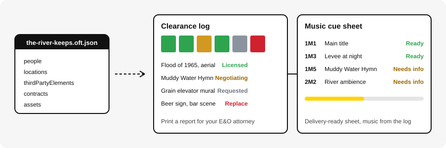

<p align="center">
  <picture>
    <source media="(prefers-color-scheme: dark)" srcset="docs/assets/logo-dark.svg" />
    
  </picture>
</p>

<p align="center">
  <b>Free tools for the paperwork behind a documentary. No accounts, no cloud, no subscriptions.</b>
</p>

<p align="center">
  <a href="https://github.com/open-filmmaker-toolkit/toolkit/actions/workflows/ci.yml"></a>
  <a href="https://github.com/open-filmmaker-toolkit/toolkit/actions/workflows/dco.yml"></a>
  
  
  
  
  
</p>

# Open Filmmaker Toolkit

Free, open-source tools and templates for documentary and independent narrative filmmakers. Open a tool in your browser, load your project file, and keep working: your data never leaves your computer.



> **Status:** Pre-launch. This repository is private while licenses go through legal review. Curious where this is headed? See the [**Roadmap**](ROADMAP.md).

## Contents

- [Quick start](#quick-start)
- [What this is](#what-this-is)
- [The tools](#the-tools)
- [How our tools work](#how-our-tools-work)
- [Shared project file](#shared-project-file)
- [Who it's for](#whos-it-for)
- [Repository layout](#repository-layout)
- [Validation](#validation)
- [Licenses](#licenses)
- [Maintainers](#maintainers)
- [Contributing](#contributing)

## Quick start

1. Clone the repo:
   ```bash
   git clone https://github.com/open-filmmaker-toolkit/toolkit.git
   ```
2. Open [`tools/clearance-log/index.html`](tools/clearance-log/index.html) in Chrome, Edge, Firefox or Safari.
3. Click **Open file** and choose [`samples/the-river-keeps.oft.json`](samples/the-river-keeps.oft.json).
4. Make a change, then save. The same file opens in the [music cue sheet](tools/music-cue-sheet/index.html).

That's it. No install, no build step, no account. Each tool is one self-contained HTML file.

## What this is

The toolkit has two halves:

1. **A directory of open-source tools that already exist,** sorted by production phase, so filmmakers don't pay for what's already free. See [TOOLS.md](TOOLS.md).
2. **Tools we build to fill the gaps,** especially the paperwork that runs on hand-built spreadsheets today: clearances, releases, rights, funding and impact.

## The tools

| Tool | Use it for | Status |
| --- | --- | --- |
| [Clearance log](tools/clearance-log/) | Tracking every piece of third-party material until it's cleared, then printing a report for your E&O attorney | First version |
| [Music cue sheet](tools/music-cue-sheet/) | Building the music cue sheet your distributor or broadcaster needs, from the music already in your clearance log | First version |
| Release tracker, credits builder, call sheet generator | Who signed what, credits, and shoot-day paperwork | Planned, see the [Roadmap](ROADMAP.md) |

Everything else we plan to build is listed by production phase in [TOOLS.md](TOOLS.md#part-2-built-here).

## How our tools work

- **Forever free.** No subscriptions, no paid tiers, no "pro" version.
- **Local-first.** Every tool runs in your browser or on your own machine. No accounts and no cloud. Your project data never leaves your computer.
- **Works offline.** Tools can be installed from the browser and used on set with no signal.
- **One shared project file.** All tools read and write the same project: people, locations, third-party elements, contracts. Enter a person once in the release tracker and they show up in your credits, clearance log and chain-of-title binder.
- **Your file, your copy.** Projects save as a file on disk that you back up and share however you already do (Drive, Dropbox, a hard drive).
- **Plain templates too.** Every tool also ships as a DOCX, spreadsheet or PDF template for people who never open the app.

## Shared project file

Tools share a local `.oft.json` project file. Its version 1 format is described by the [JSON Schema](schemas/project-v1.schema.json), with the [data model notes](schemas/README.md) and a [sample project](samples/the-river-keeps.oft.json). Tools preserve fields they do not own when saving.

## Who it's for

Documentary and independent narrative filmmakers, producers, coordinators and ADs working without a studio's back office.

## Repository layout

```text
toolkit/
|-- tools/                # One folder per tool: index.html plus its own README
|   |-- clearance-log/
|   `-- music-cue-sheet/
|-- schemas/              # JSON Schema and data model notes for the project file
|-- samples/              # Fictional sample project to try the tools with
|-- docs/assets/          # Logo and preview artwork
|-- .github/
|   |-- workflows/        # DCO and CI checks
|   `-- scripts/          # validate_repo.py, the check CI runs
|-- TOOLS.md              # Directory of existing open-source tools, plus what we build
|-- ROADMAP.md            # Milestones, each linked to its issue
|-- GOVERNANCE.md         # How decisions get made
|-- CONTRIBUTING.md       # How to contribute, DCO sign-off, CI practices
`-- README.md             # This page
```

## Validation

CI checks the project schema against the sample files, that IDs and references in samples resolve, and that every tool has a README and makes no network requests. Run the same check locally:

```bash
python3 -m pip install jsonschema
python3 .github/scripts/validate_repo.py
```

CI doesn't test browser behavior, printing or cross-tool compatibility. Those checks are manual: see [Before you open a pull request](CONTRIBUTING.md#before-you-open-a-pull-request).

## Licenses

Licensing is under legal review. Our intent:

| What | Planned license |
| --- | --- |
| Code | GPL-3.0 (AGPL-3.0 for anything hosted) |
| Templates and guides | CC BY-SA 4.0 |
| Legal forms (releases, deal memos) | CC0 or CC BY 4.0 |

Legal templates are starting points, not legal advice. Have a lawyer in your jurisdiction review anything you sign.

## Maintainers

- Basil Shadid
- Alex Perrault

See [GOVERNANCE.md](GOVERNANCE.md) for how decisions get made.

## Contributing

You don't need to code to help. Request a tool, submit a template or report a problem from the [new issue page](https://github.com/open-filmmaker-toolkit/toolkit/issues/new/choose). Code contributions are signed off under the Developer Certificate of Origin. See [CONTRIBUTING.md](CONTRIBUTING.md) for both, and our [code of conduct](CODE_OF_CONDUCT.md).
